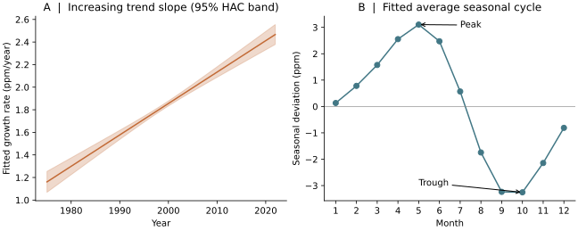
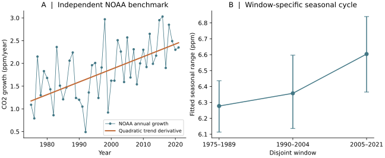

# Keeling Curve Lab

**A transparent decomposition of atmospheric CO₂ growth and seasonality.**

A reproducible study of NOAA's Mauna Loa record over 1975–2021. The project pairs
polynomial trends and seasonal harmonics with dependence-aware uncertainty,
chronological evaluation and an independent annual-growth comparison.



## Research workflow

1. Preserve the monthly calendar and flag interpolated observations.
2. Fit linear/quadratic trends with seasonal Fourier terms.
3. Estimate calendar-aware Newey–West/HAC covariance, preserving gaps.
4. Check sensitivity to lag length, harmonic order and estimation window.
5. Compare chronological holdout error and Welch frequency spectra.
6. Benchmark trend-derived growth against NOAA's annual-growth product.



## Reproduce

```bash
python -m venv .venv
source .venv/bin/activate
pip install -r requirements.txt
python analysis.py
```

The archived CSV inputs make the analysis runnable without a network connection.
The script regenerates `results.json`, derived data tables and four figures.
The source project used Python 3.13; see `VALIDATION.md` for this package's check.

## Data and interpretation

NOAA sources and download metadata are in `sources.json`; input SHA-256 hashes
are recorded in `results.json`. The study covers 564 calendar months. Original
data citations and agency notices in the NOAA files are retained.

This reproduces established CO₂ curvature and seasonality. Its contribution is
explicit verification and sensitivity analysis. Model-conditional intervals do
not represent full forecast uncertainty; the fitted derivative and NOAA annual
growth are distinct estimands. No causal or novel-estimator claim is made.

See [PROVENANCE.md](PROVENANCE.md) for publication context.
